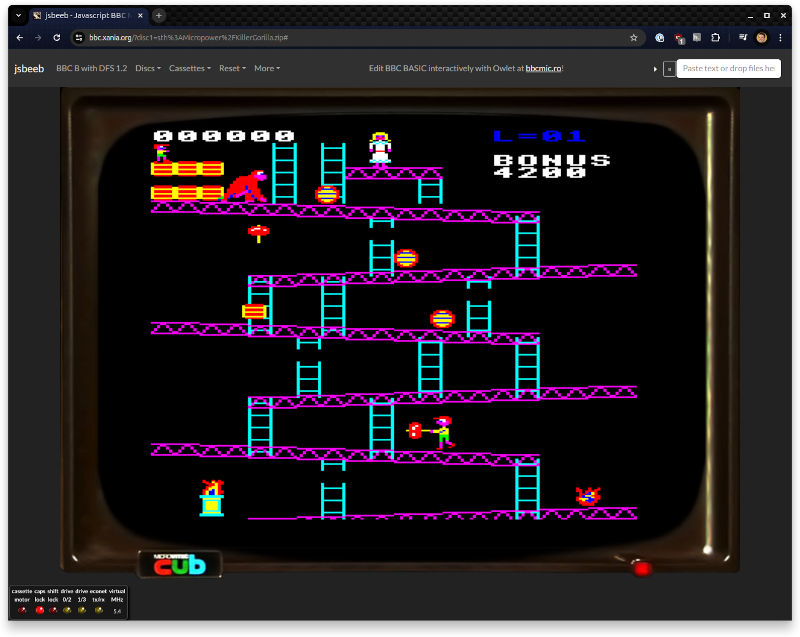

[](https://github.com/mattgodbolt/jsbeeb/actions/workflows/test-and-deploy.yml)
[](https://bbc.xania.org/coverage/index.html)

# jsbeeb - JavaScript BBC Micro Emulator

[](https://bbc.xania.org/)

A BBC Micro and other 8-bit Acorn emulator written in JavaScript and running in modern browsers. Emulates a 32K BBC B
(with sideways RAM, and with the US or German MOS or the early MOS 0.10), a 128K BBC Master, and an Acorn Atom (with
AtoMMC2 SD card interface), along with a number of different peripherals.

jsbeeb supports the browser versions listed under `browserslist` in [package.json](package.json).

## Table of Contents

- [Keyboard Mappings](#keyboard-mappings)
- [Remapping Keys](#remapping-keys)
- [Keyboard Layouts](#keyboard-layouts)
- [Discs and Tapes](#discs-and-tapes)
- [Emulator Shortcuts](#emulator-shortcuts)
- [Printer Output](#printer-output)
- [Save State and Rewind](#save-state-and-rewind)
- [Joystick Support](#joystick-support)
- [Getting Set Up to Run Locally](#getting-set-up-to-run-locally)
- [Running as a Desktop Application](#running-as-a-desktop-application)
- [URL Parameters](#url-parameters)
- [Patches](#patches)
- [Loading BASIC Files from GitHub Gists](#loading-basic-files-from-github-gists)
- [Things Left to Do](#things-left-to-do)
- [Tests](#tests)
- [Thanks](#thanks)
- [More Information](#more-information)
- [License](#license)
- [Contact](#contact)

## Keyboard Mappings

The BBC had a somewhat different-looking keyboard to a modern PC, and so it's useful to know some of the mappings:

- BBC `F0` is `F10`
- BBC `Break` key is `F12`
- BBC `:` and `*` are on the key two to the right of `L` (in the default [Physical](#keyboard-layouts) layout)

To play right now, visit [https://bbc.xania.org/](https://bbc.xania.org/). To load the default disc image (Elite in this
case), press shift-F12 (which is shift-Break on the BBC).

### Remapping Keys

Plenty of games use keys that are awkward on a modern keyboard: `COPY` (which is `End`, or `fn`+`→` on a Mac), or
`CAPS LOCK` (which on a Mac toggles rather than acting as a key you hold down). Any host key can be made to press any
BBC key by adding a `KEY.` parameter to the URL:

```
KEY.<host key>=<BBC key>
```

Add one for each key you want to change. For example, Superior Software's Space Invaders fires with `COPY`; this makes
`Enter` fire instead:

[`https://bbc.xania.org/?disc1=sth:Superior/SpaceInvaders-Superior.zip&autoboot&KEY.ENTER=COPY`](https://bbc.xania.org/?disc1=sth:Superior/SpaceInvaders-Superior.zip&autoboot&KEY.ENTER=COPY)

Superior's Frogger uses `A`/`Z`/`DELETE`/`COPY` to move; this puts it on the arrow keys:

[`https://bbc.xania.org/?disc1=sth:Superior/Frogger-Superior.zip&autoboot&KEY.UP=A&KEY.DOWN=Z&KEY.LEFT=DELETE&KEY.RIGHT=COPY`](https://bbc.xania.org/?disc1=sth:Superior/Frogger-Superior.zip&autoboot&KEY.UP=A&KEY.DOWN=Z&KEY.LEFT=DELETE&KEY.RIGHT=COPY)

And Superior's Hunchback steers with `CAPS LOCK` and `CTRL`, which the arrow keys can stand in for:

[`https://bbc.xania.org/?disc1=sth:Superior/Hunchback-Superior.zip&autoboot&KEY.LEFT=CAPSLOCK&KEY.RIGHT=CTRL`](https://bbc.xania.org/?disc1=sth:Superior/Hunchback-Superior.zip&autoboot&KEY.LEFT=CAPSLOCK&KEY.RIGHT=CTRL)

The **host key** names are jsbeeb's names for the keys on your own keyboard. A host key is identified by where it
sits, not by what it types, so these work the same on a Dvorak, AZERTY or Hungarian layout as on a QWERTY one. Most
names are what you'd expect, but note:

- `ENTER` (the BBC's `RETURN` key is called `ENTER` on the host side)
- `K0` to `K9` for the number keys, `NUMPAD0` to `NUMPAD9` for the keypad
- with Num Lock off, a keypad key counts as the key it stands in for: keypad `1` is `END`, so `KEY.END` covers
  both. A `KEY.NUMPAD1` still wins for that key
- `SHIFT_LEFT` / `SHIFT_RIGHT`, `CTRL_LEFT` / `CTRL_RIGHT`, `ALT_LEFT` / `ALT_RIGHT` to distinguish the two of each.
  Plain `SHIFT`, `CTRL` and `ALT` map both sides at once
- `WINDOWS` and `WINDOWS_RIGHT` for the Windows or Command keys, and `CLEAR` for the key an Apple
  keyboard prints that on
- `BACK_QUOTE`, `APOSTROPHE`, `SEMICOLON`, `MINUS`, `EQUALS`, `BACKSLASH`, `LEFT_SQUARE_BRACKET`,
  `RIGHT_SQUARE_BRACKET` for punctuation
- `BACKSLASH` is the key left of `Enter` on a UK keyboard (printed `#~`) and the one above it on a US keyboard
  (printed `\|`); they are the same physical key. `HASH` is accepted as another name for it. `INTL_BACKSLASH` is the
  extra key between the left shift and the `Z` that only a 102-key keyboard has

The **BBC key** names are:

```
RETURN COPY DELETE ESCAPE TAB SPACE SHIFT SHIFTLOCK CAPSLOCK CTRL
LEFT RIGHT UP DOWN
A-Z, K0-K9 (the number keys), F0-F9 (the red function keys)
SEMICOLON_PLUS MINUS COMMA PERIOD SLASH AT COLON_STAR HAT_TILDE
UNDERSCORE_POUND PIPE_BACKSLASH LEFT_SQUARE_BRACKET RIGHT_SQUARE_BRACKET

(and, on the Master's numeric keypad only)
NUMPAD0-NUMPAD9 NUMPADPLUS NUMPADMINUS NUMPADSLASH NUMPADASTERISK NUMPADCOMMA
NUMPADHASH NUMPADENTER NUMPAD_DELETE NUMPAD_DECIMAL_POINT
```

Some things to know:

- Names are case-insensitive, and a remapped key ignores the `SHIFT` state, so `KEY.ENTER=COPY` presses `COPY` whether
  or not shift is held.
- Any host key can be named here, including ones no layout uses by default, such as `PRINTSCREEN`, `SCROLL_LOCK` and
  `WINDOWS_RIGHT`. Naming one is the only way to make it press anything.
- Remapping replaces what that host key normally does; in the Space Invaders example above, `Enter` no longer presses
  `RETURN`.
- The remapping is applied on top of whichever keyboard layout is selected, and survives changing layout or model.
- If a name isn't recognised the mapping is skipped, and the emulator says so on startup, naming the parameter that
  was at fault.
- On the Atom, use the Atom's own key names (`LOCK`, `UP_DOWN`, `LEFT_RIGHT` and so on) rather than the BBC's.

The definitive lists are `keyCodes` with `keyCodeAliases` (host) and `BBC` (BBC micro) in
[`src/keymap.js`](src/keymap.js), and `ATOM` in
[`src/keymap-atom.js`](src/keymap-atom.js).

### Keyboard Layouts

A BBC keyboard is not a PC keyboard, so **Keyboard layout** in the settings offers three ways to
bridge the two. Open the settings by clicking the gear and model name on the top bar, or from
**Machine > Settings...** in the desktop app. The choice is remembered, and `?keyLayout=physical`,
`?keyLayout=natural` or `?keyLayout=gaming` sets it from a link.

**Physical** is the default, and the one to use for games. Each key presses the BBC key in the same
place on the keyboard, so `Z` is `Z` and the key two to the right of the `L` is the BBC's `:` and `*`,
whatever your keyboard is printed with. A Dvorak or Hungarian keyboard works the same as a UK one,
because only position matters.

**Natural** is for typing. Each key presses whatever the BBC needs to print the character your
keyboard produces, so a `@` gives a `@` and a `*` gives a `*`, again whatever your layout. The BBC
holds shift for a different set of characters than a PC does, which this deals with: `^` is
unshifted on a BBC and `"` is shifted, and you do not have to know that.

Two keys are exceptions, because characters alone cannot settle them. The BBC has no backtick and
most keyboards cannot type a `£` at all, so the key that would print a backtick gives a `£`
instead. And the Master's numeric keypad is a separate set of keys from the digits above the
letters, which the characters cannot tell apart, so the keypad goes by position. With Num Lock
off it is the arrows, `End` and the rest instead, as in every layout.

The Atom's natural layout works the same way, except that the Atom has a backtick (shift and `@`),
so the backtick key gives one rather than a `£`. The Atom has no `£` at all, so typing one does
nothing, and caps lock is the Atom's `LOCK`.

**Gaming** moves the BBC keys that a PC keyboard handles badly. Its main job is the BBC's `CAPS LOCK`
and `CTRL`, which sit side by side and which many games use for left and right: Zalaga and Hunchback
both do. On a PC those two are a row apart and diagonal, so this layout puts them on the left `Ctrl`
and left `Alt` instead, which are side by side under one hand. The cost is that jsbeeb's own `Alt`
shortcuts win over those keys, so while this layout is chosen you cannot hold the BBC's `CTRL` and
press a letter or digit that jsbeeb has claimed.

Whichever you choose, a `KEY.` parameter overrides individual keys on top of it, and survives
changing layout.

### Discs and Tapes

Click **Media** on the top bar to open the media window, with two disc drives and a cassette deck showing what is
loaded. Type part of a disc's name and press `Enter`: the top row goes into drive 0 and boots. Clicking a row does the
same for that row.

- **Without booting:** `Shift+Enter` or `Shift`+click loads without booting. Untick **Autoboot** (to swap data
  discs, say) and it is the other way round: the plain gestures only load and `Shift` boots. The tick starts ticked
  each time the page opens.
- **Only drive 0 boots.** Aim at drive 1 or the cassette deck with the **Into** control, by clicking a slot, or from
  its line in the LED panel under the screen; what goes there just goes in. The row and the hint under the list say what
  will happen.
- **What the list holds:** the built-in examples, the Stairway to Hell archive, the HFE archive of flux captures, the
  demos and games Bitshifters publish, games and demos from their authors' GitHub repos, your Google Drive once
  connected, discs kept in this browser, and files opened this session. With nothing typed, what you loaded most
  recently, on this visit or an earlier one, comes first. The arrow keys walk the rows. A Bitshifters or GitHub row
  links to its page or repo.
- **A disc that needs a Master 128** switches the emulator to one: without asking when it is to boot, after asking
  otherwise.
- **Files from this computer:** drop one on the page, or open one from the window's footer. A disc goes into the
  aimed drive and a tape into the deck. The footer also makes a blank disc in this browser or on Google Drive, and
  connects Google Drive. Save states load from the **State** menu; see [Save State and Rewind](#save-state-and-rewind).
- **Each drive** has an eject latch, a 40/80 track switch (which pins the drive, so `drive0Tracks=` follows it in the
  URL), a **Save** menu to download the disc or copy it to Google Drive, and **Surface** to open the disc visualiser.
- **The URL** names what is loaded and says whether the last load into drive 0 booted, so a link copied afterwards
  does the same. A file from this computer is left out, so a link never boots one. See
  [URL Parameters](#url-parameters).

[docs/media-sources.md](docs/media-sources.md) says how the sources fit together and what adding one takes.

### Emulator Shortcuts

| Shortcut         | Action                                                                |
| ---------------- | --------------------------------------------------------------------- |
| `Alt-S`          | Enter the debugger, or leave it and resume                            |
| `Alt-D`          | Show or hide the debug panels, leaving the machine running or stopped |
| `Alt-P`          | Pause emulation, or resume                                            |
| `Alt-T`          | Toggle turbo (fast-as-possible)                                       |
| `Alt-B`          | Open printer output window                                            |
| `Alt-W`          | Open rewind scrubber                                                  |
| `Alt-M`          | Media window, aimed at drive 0                                        |
| `Alt-Shift-M`    | Media window, aimed at drive 1                                        |
| `Alt-C`          | Media window, aimed at the cassette                                   |
| `Alt-1 to Alt-8` | Hold an accessibility switch down                                     |

Every shortcut is on `Alt`, so that `Ctrl` belongs to the emulated machine: `Ctrl-B` is `VDU 2` on a BBC, `Ctrl-L`
clears the screen, and jsbeeb should not be taking any of them.

### Printer Output

Anything the machine prints is captured whether or not the printer window is open, so programs that print (with `VDU 2`, `*FX5,1` and the like) run rather than waiting for a printer that is not there.

Press `Alt-B` to open a window showing what has been printed so far; it then keeps up with the output as it arrives. Only the most recent output is kept, roughly a dozen pages' worth, so a program printing forever cannot fill memory.

### Save State and Rewind

Save and load full emulator state snapshots from the **State** menu.
A save state dropped on the page is restored too.

The emulator continuously captures snapshots into a 30-slot rewind buffer (~1 per second). Open the rewind scrubber from **State > Rewind** or press **Alt-W** to browse recent states as a visual filmstrip:

- **Left/Right arrows**: navigate between snapshots (the main screen updates live)
- **Click** a thumbnail to jump to that point
- **Enter**: commit selection and close the panel
- **Escape**: cancel and restore the original state

### Joystick Support

jsbeeb supports both USB/Bluetooth gamepads and mouse-based analogue joystick emulation. Note that BBC Micro joysticks use inverted axes:

- X-axis: Left = 65535, Right = 0
- Y-axis: Up = 65535, Down = 0

A gamepad presses the emulated machine's keys, and which key each control presses can be changed from the URL in the
same way as [remapping the keyboard](#remapping-keys):

```
GP.<gamepad control>=<key>
```

By default the D-pad presses the "Snapper" keys (`Z`, `X`, `:`, `/`), the `A` button presses `RETURN` and `Start`
presses `SPACE`. On the Atom the D-pad presses `Q`, `=`, `3` and `G` (up, down, left, right), `A` presses the right
arrow and `Start` presses `SPACE`; the D-pad and `A` also work the AtoMMC's joystick port, whichever of the two a
game reads. To play Superior's Space Invaders on a pad, where `COPY` fires:

[`https://bbc.xania.org/?disc1=sth:Superior/SpaceInvaders-Superior.zip&autoboot&GP.FIRE=COPY`](https://bbc.xania.org/?disc1=sth:Superior/SpaceInvaders-Superior.zip&autoboot&GP.FIRE=COPY)

The gamepad control names are:

- `FIRE`: every button at once, which is usually what you want for a one-button game
- `UP` `DOWN` `LEFT` `RIGHT`: both analogue sticks at once, plus one face button each (`UP` is also `A`, `DOWN` is
  `X`, `LEFT` is `Y`, `RIGHT` is `B`)
- `UP1` `DOWN1` `LEFT1` `RIGHT1`: the left stick only; `UP2` `DOWN2` and so on: the right stick only; `UP3` `DOWN3`
  and so on: the face buttons only
- `A` `B` `X` `Y` `START` `BACK` `LB` `RB` `LT` `RT`: individual buttons, by their Xbox 360 names
- `FIRE1` `FIRE2`: clicking the left and right sticks

The key names are the same as for the keyboard, the Atom's own on the Atom. As with `KEY.`, the whole parameter is
case-insensitive, so `gp.fire=copy` works too. Digits may be written either way round: `GP.A=1` and `GP.A=K1` both
press `1`. The D-pad's default mapping can't currently be changed.

The older `LEFT=`, `RIGHT=`, `UP=`, `DOWN=` and `FIRE=` parameters (no `GP.` prefix, and in capitals) still work and
mean the same thing.

## Getting Set Up to Run Locally

### Prerequisites

- Node.js (https://nodejs.org/)
- npm (comes with Node.js)

### Installation

1. Clone the repository:
   ```sh
   git clone https://github.com/mattgodbolt/jsbeeb.git
   cd jsbeeb
   ```
2. Install dependencies:
   ```sh
   npm install
   ```
3. Start the local webserver:
   ```sh
   npm start
   ```
4. Visit `http://localhost:5173/` in your browser.

jsbeeb uses Node.js and vite to afford simple and standard web development tooling and third-party library access
without lots of painful copy/paste or wheel-reinventing, as well as the ability to better run tests, and "pack" up the
site to make it smaller and faster to load when it's deployed to [https://bbc.xania.org](https://bbc.xania.org).

Google Analytics is only on the deployed site: the deploy job builds with `GA_MEASUREMENT_ID` set from the repository
variable of that name, and every other build (`npm start`, a clone's own build, the tests and the desktop app) has no
analytics on the page and sends nothing. `npm run test:e2e` builds with a dummy id and answers Google's requests
itself, so it can check what the page would send; it answers every other outside request from the stand-ins in
`tests/playwright/offline`, and blocks anything else and reports it as one of the page's problems.

## Running as a Desktop Application

jsbeeb can also run as a standalone desktop application using Electron. Prebuilt packages (Debian/Ubuntu `.deb`,
Fedora/RHEL `.rpm` and a Windows installer) are attached to each
[GitHub release](https://github.com/mattgodbolt/jsbeeb/releases), or you can build your own:

### Running in Development

```sh
npm run electron
```

This automatically builds the latest code before launching Electron.

### Building Distributable Packages

To build packages for Linux distribution:

```sh
npm run build
npm run electron:build
```

This creates two package formats in `out/dist/`:

- **Debian/Ubuntu**: `.deb` package
- **Fedora/RHEL**: `.rpm` package

**Why no Snap packages?** electron-builder's snap support uses the outdated `gnome-3-28-1804` platform (Ubuntu 18.04), which causes GPU driver incompatibilities on modern systems, resulting in MESA loader failures and segfaults. While we were able to work around the initial Wayland issues (electron-builder sets `DISABLE_WAYLAND=1` by default, fixed with `allowNativeWayland: true`), the GPU problems proved insurmountable. The snap builder hasn't been updated to support modern bases like `core22` or `core24`. The `.deb` package works perfectly on all Debian-based systems.

**Note for Ubuntu/Debian users:** If you encounter RPM build errors, you may need to use the system FPM package manager instead of electron-builder's bundled version. First, install the required dependencies:

```sh
sudo apt-get install ruby rubygems build-essential
sudo gem install fpm
```

Then build with:

```sh
USE_SYSTEM_FPM=true npm run electron:build
```

### Installing the Packaged Application

**Debian/Ubuntu:**

```sh
sudo apt install ./out/dist/jsbeeb_<version>_amd64.deb
```

**Fedora/RHEL/CentOS:**

```sh
sudo rpm -i out/dist/jsbeeb-<version>.x86_64.rpm
```

## URL Parameters

- `autoboot` - fakes a shift break
- `disc1=XXX` - loads disc XXX (from the `discs/` directory) into drive 0
- `disc2=XXX` - as above, into drive 1
- `disc1=local:YYY` - creates a local disk YYY which will be kept in browser local storage
- `disc1=sth:ZZZ` - loads disc ZZZ from the Stairway to Hell archive
- `disc1=hfe:ZZZ` - loads disc ZZZ from the HFE archive of flux captures
- `disc1=bitshifters:ZZZ` - loads disc ZZZ from [Bitshifters](https://bitshifters.github.io/), e.g.
  `bitshifters:bs-paradroid.ssd`
- `disc1=github:OWNER/REPO/PATH` - loads the disc at PATH in a public GitHub repo's default branch, e.g.
  `github:mattgodbolt/frogman/frogman_rebuilt.ssd`. `github:OWNER/REPO@REF/PATH` loads it from a branch, tag or
  commit instead, and `@~latest` from the tag of the repo's latest release. The disc has to be committed to the
  repo; a release asset will not load. See [docs/media-sources.md](docs/media-sources.md#github)
- `drive0Tracks=40` / `drive0Tracks=80` - fixes drive 0's 40/80 track switch, as the switch on the back of a real
  drive did. `drive1Tracks` does the same for drive 1. Left alone, each drive follows whatever disc is loaded into it:
  a 40 track image is laid out the way a 40 track drive wrote it, on every other track of the surface, and the drive
  double steps to read it. `40` reads an 80 track disc through a double stepping head, which is as much of a mess as it
  was in 1985. `80` turns all of this off for that drive, loading every image the way jsbeeb did before it could tell
  them apart. [docs/disc-track-layouts.md](docs/disc-track-layouts.md) explains how an image's layout is worked out.
- `tape=XXX` - loads tape XXX (from the `tapes/` directory)
- `tape=sth:ZZZ` - loads tape ZZZ from the Stairway to Hell archive
- `tape=github:OWNER/REPO/PATH` - loads a tape from a public GitHub repo, as `disc1=github:` does a disc
- `KEY.X=Y` - makes host key `X` press BBC key `Y`, e.g. `KEY.ENTER=COPY`. See
  [Remapping Keys](#remapping-keys).
- `GP.X=Y` - makes gamepad control `X` press key `Y`, e.g. `GP.FIRE=COPY`. See
  [Joystick Support](#joystick-support).
- `patch=P` - applies a memory patch `P`. See below.
- `loadBasic=X` - loads 'X' (a resource on the webserver) as text, tokenises it and puts it in `PAGE` as if you'd typed
  it in to the emulator
- `embedBasic=X` - loads 'X' (a URI-encoded string) as text, tokenises it and puts it in `PAGE` as if you'd typed it in
  to the emulator
- `autorun` - types `*TAPE` then `*/` to run from tape. In conjunction with `loadBasic` it types `RUN`.
- `autochain` - types `*TAPE` then `CH.""` to run from tape.
- `autotype` - types whatever you put after. e.g. `&autotype=PRINT"Matt is cool"%0a` (return is URI escaped to `%0a`)
- `embed` - Remove the margins around the screen, hide most navigation entries and make the page background
  transparent (intended for use when running within an iframe in a third-party site).
- `touchkeys` - offers the on-screen BBC keyboard, which otherwise appears only on a touch screen or in a window up to
  700px wide (and never on a landscape phone, embedded, or on the Atom).
- `cpuMultiplier=X` speeds up the CPU by a factor of `X` relative to the peripherals: video, sound and the VIAs keep
  running at their real-world rates. May be fractional or below one to slow the CPU down. NB disc loads become
  unreliable with a too-slow CPU, and running too fast might cause the browser to hang.
- `tubeCpuMultiplier=X` overclocks the second processor by a factor of `X`, which may be fractional. `1`, the default,
  runs it at the real part's own clock: 3MHz for the 6502 second processor a BBC B takes, 4MHz for the 65C102 Turbo
  board a Master takes. Below about 2.2MHz the MOS's unhandshaken tube transfers lose data.
- `sbLeft` / `sbRight` / `sbBottom` - a URL to place left of, right of, or below the cub monitor. The left and right
  should be around 648 high and the bottom image should be around 896 wide. Left and right wider than 300 will run into
  problems on smaller screens; bottom taller than 100 or so similarly.
- `videoCyclesBatch` - the number of video cycles to batch up before running the video emulation. Defaults to zero:
  anything higher leads to emulation inaccuracies. Useful for showing why accuracy is important, even if less efficient.
- `rom` - load the given URL or path as an extra ROM, in the highest sideways ROM bank the machine leaves free. A URL
  must allow cross-site requests, and `github:OWNER/REPO/PATH` loads a ROM from a public GitHub repo as
  `disc1=github:` does a disc. Doesn't support the sth: pseudo URL unlike `disc` and `tape`, but if given a ZIP file
  will attempt to use the `.rom` file assumed to be within. May be given more than once.
- `rom.N=X` - loads ROM `X`, named as for `rom`, into sideways bank `N`, 0 to 15 (10 to 15 may also be written A to
  F), e.g. `model=Master&rom.7=github:mattgodbolt/xmos/original.rom`. If the model has sideways RAM in that bank, the
  ROM goes into the RAM and can still be written. A bank that already holds a ROM, the model's own (BASIC, a filing
  system) or one a fitted peripheral needs (Music 5000, teletext, Econet), cannot be named; the boot stops with an
  error saying what is there. The ROMs `rom` loads go in the banks left over. The stock BBC B (`model=B-stock`) has
  only four ROM sockets, banks 12 to 15, so it takes only those, and of them only the two AUX sockets, 14 and 15, that
  BASIC and the DFS leave empty.
- `labels=X` - loads the label file at URL or path `X` (which must allow cross-site requests) so the debugger shows
  its names for addresses, ahead of the built-in symbol sets: BeebAsm's `-d` or `-dd` output (with `-labels`), VICE's
  (`al C:1900 .start`, as VICE's `save_labels` and cc65's `-Ln` write them) or b-em's `name=$1900`. May be given
  more than once. `labels.N=X` ties the file's names for &8000 to &BFFF to sideways bank `N`, named as for `rom.N`,
  so they show only while that bank is paged in. A label file dropped on any debugger panel loads the same way, for
  that page only; the line under the disassembly lists the files loaded, with the bank each is for and a button to
  forget it.
- `benchmark=X` - measures the emulator's speed on the benchmark workload `X`, one of those in
  `public/benchmarks/workloads.json`, on the model it names there (e.g. `benchmark=elite`, or
  `benchmark=master-shadow&model=Master`) instead of starting as usual. It runs the workload unthrottled from its
  snapshot, warms up, then times ten emulated seconds three ways: a normal run with the copy and present, the video
  chip with nothing painted, and the CPU with fake video. A dialog shows one line with every figure to paste;
  `window.jsbeebBenchmark` holds the same for scripts, and its `done` resolves when the run ends. Nothing is sent to
  Google Analytics. After a successful run the machine carries on with the workload once the dialog is closed; after a
  failure it stays stopped. `fakeVideo`, `frameSkip`, `cpuMultiplier`, `videoCyclesBatch` and `lowLatency` are
  refused alongside it, as they change what is measured, and so is a machine fitted otherwise than the workload's
  `fittings` there say (a co-processor, Music 5000, teletext adaptor, Econet or VideoNuLA).
- (mostly internal use) `logFdcCommands`, `logFdcStateChanges` - turn on logging in the disc controller.
- `noseek` - no disc drive noise: the motor, the head's clicks and runs all silent, and nothing scheduled for them.
- `audioDebug` - show the audio lead chart, and log one console line per second in which the emulator tick ran late or the sound stalled or skipped.
- `audioLatencyMs` - how far the sound runs behind the emulator, in milliseconds (default 20). Raising it lets the sound ride out longer stalls of the emulator, at the cost of lagging the picture by that much.
- `audioOutput` - what the sound chip is heard through: `speaker` (the default: the board's output stage and the
  internal speaker and case, fitted to recordings of a Master 128), `board` (the board's output stage alone, as at
  its line-level socket) or `off` (the chip resampled and nothing else). The top bar and the settings dialog
  have the same choice, and remember it. See [docs/audio-path.md](docs/audio-path.md) for the path, the Master's circuit and what a real
  machine measures.
- `speakerAmount` - how much of the speaker's character to apply, from 0 (the same as `board`) to 1 (as measured,
  the default). The slider next to the sound output, on the top bar and in the settings dialog, sets it live
  and remembers it.
- `audiofilterfreq` / `audiofilterq` - the corner frequency in Hz and the Q of the lowpass modelling the board's output
  filter, applied to the sound chip before it is resampled. The defaults, 7234 and 0.696, are the Beeb's own.
  `audiofilterfreq=0` turns the whole output path off.
- `palPersistenceMs` / `rgbPersistenceMs` - the phosphor afterglow of the PAL TV and RGB monitor displays, the time
  in milliseconds the last picture takes to fade under the next, from 0 (none) to 500; the slider in the settings
  dialog sets the showing display's amount live and remembers it.
- `displayMode=X` - picks the display: `rgb` (the default, a plain monitor), `pal` (a television fed by the Beeb's UHF modulator)
  or `xbr` (an upscaler, see [docs/xbr-display-mode.md](docs/xbr-display-mode.md)). The top bar has the same choice, and remembers it.

### Atom-specific parameters

- `model=Atom` - select the Acorn Atom (MMC) model. Other Atom variants: `Atom-Tape`, `Atom-Tape-FP`, `Atom-DOS`.
- `mmc=XXX` - load an MMC/SD card image (ZIP) for the Atom.

Atom models can also be selected automatically by hostname: any hostname starting with `atom` (e.g. `atom.xania.org`)
defaults to the Atom model.

## Patches

Patches can be applied by making a `patch=P` URL parameter. `P` is a sequence of semicolon-separated patches of the form
`@XXXX,YYYY:ZZZZZ,...` where the `@XXXX` specifies a PC address to breakpoint, the `YYYY` is the address to patch and
the `ZZZZ` is the data to write at address `YYYY`. The `@` part is optional, but is handy to ensure the code you want to
patch has actually loaded. For example: `patch=@31a6,0769:6e4c4d48465a` which is a patch for the default Elite image.
Once the PC has reached `$31a6`, the bytes at `0769` are replaced with `6e4c4d48465a`.

## Loading BASIC Files from GitHub Gists

1. Create a gist with your code. https://gist.github.com/ - here's
   an [example](https://gist.github.com/mattgodbolt/fc8d6f3d6e5e015dce399013719c8341)
2. Get the "Raw" link by clicking "raw" and copying the URL. In the case above
   that's: https://gist.githubusercontent.com/mattgodbolt/fc8d6f3d6e5e015dce399013719c8341/raw/bd5cb4314bfc3ee4330783ecf82cb329a36b915c/foo.bas
3. Add that after "https://bbc.xania.org/?autorun&loadBasic=" or similar, for
   example, [this link](https://bbc.xania.org/?loadBasic=https://gist.githubusercontent.com/mattgodbolt/fc8d6f3d6e5e015dce399013719c8341/raw/bd5cb4314bfc3ee4330783ecf82cb329a36b915c/foo.bas&autorun)

Note that every update you make means you need to make a new raw link.

## Things Left to Do

If you're looking to help:

- Play lots of games and report anything that doesn't behave like the real machine, either on
  [GitHub](https://github.com/mattgodbolt/jsbeeb/issues) or by email (matt@godbolt.org).
- Pick something from the [issue tracker](https://github.com/mattgodbolt/jsbeeb/issues): there's a mix of emulation
  accuracy work, missing hardware and peripherals, user interface improvements and performance ideas in there, at all
  levels of difficulty.

## Tests

For general correctness, there are several tests in the `tests` directory, including:

- Klaus Dormann's exhaustive [test of all documented opcodes](https://github.com/Klaus2m5/6502_65C02_functional_tests)
  for 6502 and 65C12. This is brought in as a git submodule from a forked version of Klaus's original as it needed a few
  tweaks to get 65C12 working.
- hoglet's Binary Coded Decimal tests.
- @dp111's [timing tests](https://github.com/dp111/6502Timing). Also brought in as a git submodule.
- A public domain Commodore 64 6502 test suite which tests every 6502 opcode (documented or otherwise) for every
  possible input and flags condition.
- Some tests by @scarybeasts testing VIA and 65C12 functionality.

For timing correctness, we have:

- A timing test program written by Rich. It has been run on a real live BBC B and the results are in the directory. An
  SSD of the same tests is in the `discs/` directory.
- Some of Kevin Edwards' protection systems (stripped of the games themselves). These are extremely timing- and
  correctness-sensitive when it comes to the timers and interrupts of the BBC.
- Some 65C12-specific read-modify-write tests written by Ed Spittles.

Tests are run via npm scripts: `npm test` runs the whole suite. The vitest suites are `npm run test:unit`,
`npm run test:integration` and `npm run test:shader`; CPU tests are `npm run test:cpu`, and the browser tests are
`npm run test:e2e` (the shader and browser tests need Chrome installed). Please note it can take a while to run the
whole test suite.

## Thanks

jsbeeb was heavily based on Sarah Walker's C [B-Em emulator](https://github.com/stardot/b-em); thanks to her for her
hard work and for open sourcing her code. B-em is now being maintained by a group of enthusiasts - thanks to them too!

Huge thanks to Richard Talbot-Watkins for his advice and help along the way in fathoming out the instruction timings,
interrupt fun, video code rewrite and for being such a good pal all these many years!

Thanks to [Michael Borcherds](https://twitter.com/mike_geogebra) for his help; improving the keyboard layouts and
handling in JavaScript, reporting issues, chasing down game bugs and much more.

Thanks to [David Banks](https://github.com/hoglet67) (hoglet) for his help in testing the gnarly BCD flag behaviour on
real live BBCs.

Cheers to [Ed Spittles](https://github.com/BigEd) for testing various interrupt timing code on a real BBC.

Thanks to Chris Jordan for his thorough testing, bug reports, ideas and help.

Huge thanks to [Andrew Hague](https://github.com/CommanderCoder) (CommanderCoder) for the Acorn Atom emulation
support. Andrew developed the original Atom implementation including the MC6847 video chip, 8255 PPIA, AtoMMC2 SD card
interface, Atom keyboard mapping, tape support, and speaker output. His work in [PR #505](https://github.com/mattgodbolt/jsbeeb/pull/505)
was incrementally merged and refined into the codebase.

The on-screen keyboard's legends are in Dakota Felder's [Open Gorton](https://github.com/dakotafelder/open-gorton)
font, used under the MIT licence; see [public/fonts/open-gorton](public/fonts/open-gorton).

A lot of the early development used the amazing [Visual 6502](http://visual6502.org/) as reference for intra-instruction
timings. Amazing stuff.

Special shout out to the users of the [6502 Forums](http://forum.6502.org/)

## More Information

I've written a lot about how the innards work on [my blog](http://xania.org) in
the [emulation](http://xania.org/Emulation-archive) section. I gave a presentation on how it all fits together at work,
and posted the [video up on YouTube](https://www.youtube.com/watch?v=37jyHQT7fXQ). I have another presentation at
[ABug](https://www.youtube.com/watch?v=ABmwJXMLzYM).

## License

This project is licensed under the GNU General Public License v3.0 (or later); see the [LICENSE](LICENSE) file for
details.

## Contact

For support or questions, please contact Matt Godbolt at matt@godbolt.org.
